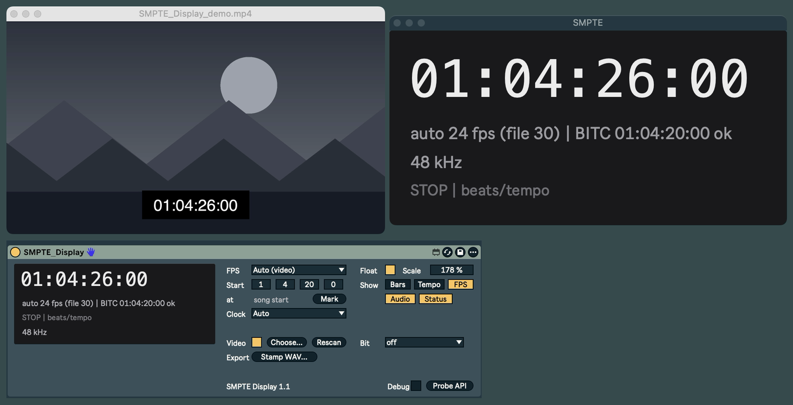

<div align="center">

# SMPTE Display

**A Max for Live device for use with Ableton Live 12** that shows SMPTE timecode in a floating window over the Arrangement View — type a timecode to jump straight there.

[](https://github.com/emile-lab/SMPTE-Display/releases/latest)
[](https://www.ableton.com/live/max-for-live/)
[](#requirements)
[](LICENSE)

[한국어](README.md) · **English**



### [⬇️ Download 1.1](https://github.com/emile-lab/SMPTE-Display/releases/latest)

<sub>By downloading or using SMPTE Display you agree to the [LICENSE](LICENSE).</sub>

</div>

> [!NOTE]
> Bug reports and feedback are welcome in [Issues](https://github.com/emile-lab/SMPTE-Display/issues/new/choose). The device panel shows the version at the bottom (`SMPTE Display 1.1`).

---

## Features

| Feature | Description |
|---|---|
| 🕒 **Floating timecode window** | Shows the current position as `HH:MM:SS:FF` in a small window above Live. Pick which lines to show (bars, tempo, FPS, audio, status) and drag the window corner to resize it (50–400 %). |
| 📍 **Start TC on any bar** | The locator whose name starts with `SMPTE` is where the Start TC (e.g. `01:00:00:00`) sits. Click a bar and press **Mark** to create it; drag the locator and the timecode follows. The bars before it run as pre-roll (`00:59:52:00` …). |
| ⌨️ **Locate by timecode** | Click the window, type `01:23:45:12`, press **Enter** to jump. **Space** jumps and starts playback. |
| 🎬 **Video FPS detection** | Uses the frame rate of the video clip (MOV / MP4 / M4V) in your Arrangement. |
| 🔎 **Burned-in timecode (BITC) reading** | Reads the timecode printed in the video picture, sets the Start TC and FPS for you, and shows `sync OK` while playing. Follows the on-screen timecode **even when it runs at another rate than the file** (e.g. 24 fps burn-in in a 30 fps file). *(macOS)* |
| 📤 **Export timecode** | Writes a standard BWF timestamp (EBU Tech 3285) into WAV files exported from Live, so editors and DAWs that spot files to their original timestamp place them at the picture's timecode. Your Live Set is not touched. |
| 🎯 **Frame accurate** | Even when you stop or click exactly on a frame boundary, the display shows the same frame as Live's video window. The playhead is never moved, so your clip selection stays put. |
| 📈 **Tempo automation aware** | Displays and locates by real elapsed time, even across tempo ramps. |

Frame rates: 23.976 · 24 · 25 · 29.97 (NDF / DF) · 30 · 50 · 59.94 (NDF / DF) · 60

## Requirements

| Item | Details |
|---|---|
| Ableton Live | **Live 12 Suite**, or **Standard + Max for Live** (tested on 12.4.5) |
| OS | **macOS 11+** (Apple Silicon / Intel). Burned-in timecode reading is macOS only. |
| Windows | Not tested. Burned-in timecode reading is not available. |
| Extra installs | None |

## Install (3 steps)

**1. Download and unzip.**
Get `SMPTE_Display_1.1.zip` from [Releases](https://github.com/emile-lab/SMPTE-Display/releases/latest) and unzip it.

**2. Remove the macOS quarantine flag.** *(needed for burned-in timecode reading)*
macOS quarantines downloaded files, which stops the timecode reader (`bitc_reader`) from running. Open **Terminal** and run the command below, adjusting the path to where you unzipped it:

```bash
xattr -dr com.apple.quarantine ~/Downloads/SMPTE_Display_1.1
```

**3. Copy to your User Library and add it to a track.**
1. Copy the whole `SMPTE_Display` **folder** to
   `User Library/Presets/Audio Effects/Max Audio Effect/`
   *(find your User Library location in Live under **Settings → Library**).*
2. In Live's browser, drag `SMPTE_Display.amxd` from **User Library** onto a track — the **Main track** is recommended. Audio passes through unchanged.

> [!IMPORTANT]
> `SMPTE_Display.amxd`, the five `.js` files and `bitc_reader` **must stay in the same folder**. Moving the `.amxd` on its own will not work.

> [!TIP]
> **Updating from an earlier version (Beta):** replace the old `SMPTE_Display` folder, then **delete the device from your Set and drag it in again**. Instances already in a Set may keep running the old version.

## Quick start

1. Switch to the **Arrangement View** — the timecode window appears in the middle of the screen.
2. Pick an **FPS** on the device. `Auto (video)` (default) follows the burned-in timecode of the video, else the video file's rate, or uses 24 fps if there is no video.
3. Press play — the timecode runs in real time.
4. **Click** the timecode → type → **Enter** to locate.

### Input examples

| Typed | Goes to |
|---|---|
| `01:23:45:12` | 01:23:45:12 |
| `01:23:45;12` | 01:23:45:12 (drop-frame notation) |
| `1:30:00` | 00:01:30:00 (filled from the right) |
| `01101010` | 01:10:10:10 (digits only) |

### Keys

| Key | Action |
|---|---|
| **Enter** | Locate. Invalid input turns red and nothing moves. |
| **Space** (while typing) | Locate, then play. |
| **Space** (not typing) | Play / stop |
| **Esc** | Cancel input (also cancels after 10 s without typing). |

### Start TC on a chosen bar

To put `01:00:00:00` on bar 5 and use the bars before it as pre-roll, as in film work:

1. Set **FPS** and **Start** (e.g. `01:00:00:00`).
2. Stop playback, click bar 5 in the Arrangement and press **Mark**. A locator named `SMPTE 01:00:00:00` appears there.
3. Bar 5 now reads `01:00:00:00` and bar 1 reads that much earlier (`00:59:52:00` at 120 BPM in 4/4). Drag the locator and the timecode follows; Undo works as usual.

- You can also make the locator yourself, with any name that starts with `SMPTE` (e.g. `SMPTE reel 2`). With several, the earliest one is used.
- When you change Start, a name the device gave (`SMPTE 01:00:00:00`) follows it; a name you typed is kept. The device never deletes or moves a locator.
- Without such a locator the song start is the reference (like the Offset in 1.0).
- With tempo automation, playback has to pass the locator once before its time is exact; until then the status line shows `~ start (play past the SMPTE locator)`.

### Device controls

| Control | Description |
|---|---|
| **FPS** | Timecode frame rate. `Auto (video)` follows the burned-in timecode, else the video file. |
| **Start** / **Mark** | Start TC: the timecode at the `SMPTE` locator, or at the song start without one (e.g. `01:00:00:00`). **Mark** creates that locator at the bar you clicked. Set automatically when burned-in timecode is found. |
| **Float** / **Scale** | Floating window on/off / size 50–400 %. Drag the number or the window corner. |
| **Show** | Lines in the floating window: **Bars**, **Tempo** (tempo and time signature), **FPS**, **Audio**, **Status**. All off leaves the timecode alone. |
| **Clock** | How time is computed. Leave on `Auto` in most cases. |
| **Bit** | Bit-depth label for display only — Live does not expose the real value. |
| **Choose…** / **Rescan** | Pick a video file yourself / search the Arrangement for video again. |
| **Stamp WAV…** | Write the timecode into exported WAV files — see [below](#export-timecode-bwf-timestamp). |

## Burned-in timecode (BITC) — macOS

If the video picture has a timecode burned in, the device reads eleven frames and **sets the Start TC automatically.** With an `SMPTE` locator, the burned-in timecode at that locator becomes the Start TC. The on-screen timecode wins when it runs at another rate than the file (e.g. a 24 fps edit exported as 30 fps, repeating every 5th frame): FPS `Auto` uses the on-screen rate, and inside the video clip the display shows **exactly what the picture shows, repeated frames included.** Typing a timecode goes to the first frame that shows it.

| Info line | Meaning |
|---|---|
| `BITC 00:59:56:00 ok` | Read successfully; Start TC applied. |
| `auto 24 fps (file 30)` | The picture counts 24 fps, the file is 30 fps; the display follows the picture. |
| `BITC mismatch 8/11` | Readings disagree; nothing applied. |
| `BITC 24 fps != 30 fps` | You chose an FPS that differs from the burn-in. Set FPS to `Auto (video)` and it follows the picture at once. |
| `BITC error: reader blocked (xattr)` | macOS blocked the timecode reader (`bitc_reader`). Run the `xattr` command in [Troubleshooting](#troubleshooting). |
| `sync OK` / `sync +2 fr` | Sync status during playback (checked about every 5 s). |
| `clip off frame grid` | The video clip sits between frame boundaries. Turn on snap and align it to the grid. |

When you reopen a saved Set, **the saved Start TC is kept**, so a value you adjusted by hand survives. Press **Rescan** to apply the burn-in value instead.

## Export timecode (BWF timestamp)

WAV files exported by Live carry no timecode, so editors and other DAWs put them at `00:00:00:00`. **Stamp WAV…** writes the **timecode of the Render Start** into the exported files as a standard BWF timestamp (EBU Tech 3285 `bext`, `iXML`). Editors and DAWs that read it place the files at the picture's timecode when you spot them to their original timestamp.

1. Export as usual with **Export Audio/Video**.
2. Right after the export, before you move the start marker, press **Stamp WAV…** on the device and pick the exported WAV. For *All Individual Tracks* exports, pick any one file and the files exported with it are stamped too.
3. The status line shows the result, e.g. `TC 01:04:23:10 stamped: 5 WAVs (video clip)`. The names of the stamped files go to the Max Console.

- **Your Live Set is not changed** — clips, automation and track sync stay exactly as they are, and the audio data is not altered by a single byte. Only timecode information is added to the files.
- The timestamp is **sample-accurate**: it is the first sample inside the labelled frame. When the Start TC came from the burned-in timecode, it is computed from the video's actual position, even for a clip placed between frame lines.
- **Finding the Render Start:** Live does not tell devices the export range.
  - A time selection moves the start marker to its start, so the **start marker** is used.
  - An export whose length equals the whole Set starts at **0**.
  - If the length also fits the video clip, the loop brace or a pair of locators, the status line says `length also fits …`.
  - The brackets on the status line say which one was used.
- If the result is not what you expected, click the Render Start position in the Arrangement to put the start marker there and press **Stamp WAV…** again. Stamping again replaces the previous value.
- **Files stamped together** are WAVs in the same folder with the same length and sample rate, saved within one minute of the picked file. They must also be unstamped or carry the same stamp as the picked file. A file from another export that already has a different timecode is never changed.
- Files on external drives work. Read-only files are not changed.
- The file is rewritten, so Finder tags and comments on it are not kept.
- Checked with ffprobe, MediaInfo and BWF MetaEdit (EBU Tech 3285 conformance): exact values at 44.1–96 kHz and eight frame rates.
- WAV only (AIFF / FLAC / MP3 have no standard timestamp). RF64 files over 4 GB are not supported.

## Good to know

- **SMPTE timecode here is elapsed time, not bars and beats.** Changing the tempo changes the timecode at a given bar — which is what you want for picture sync.
- The floating window shows **only in the Arrangement View** and hides in the Session View. It does not move with Live's main window.
- **Locating past the end of the Set** creates a MIDI track called `SMPTE extend` with a short empty clip, because Live cannot move beyond the Set's end. You can undo it or delete it.
- The device never moves the playhead on its own — only when you type a timecode to locate. Your clip selection in the Arrangement is kept.
- If playback stops within about the last 15 ms of a frame, Live's video window can show the next frame (one frame ahead of the display). That is Live's video window and the device cannot correct it.
- After typing in the floating window it keeps keyboard focus. Click Live's window once to use Live shortcuts again.
- The device makes no network connections and collects no personal data. Video and WAV files are read and written only on your computer.

## Troubleshooting

<details>
<summary><b>The floating window doesn't appear</b></summary>

- Make sure you are in the Arrangement View (Tab key).
- Check that **Float** is on.
- It may be on another display. Remove and re-add the device — it opens in the middle of the display that holds Live's window.
</details>

<details>
<summary><b>Burned-in timecode isn't detected / <code>BITC error</code></b></summary>

- `BITC error: reader blocked (xattr)`: macOS blocked the downloaded reader. This is the most common cause. If you already copied the folder into your User Library, run the command on the **installed** folder:
  ```bash
  xattr -dr com.apple.quarantine "$HOME/Music/Ableton/User Library/Presets/Audio Effects/Max Audio Effect/SMPTE_Display"
  ```
  (Adjust the path if your User Library is elsewhere.) Then press **Rescan**.
- `BITC error: reader missing`: `bitc_reader` is not in the same folder as `SMPTE_Display.amxd`. Copy the whole folder again.
- `BITC error: reader not executable`: unzip again and copy the whole folder.
- Use MOV / MP4 / M4V video. Burned-in timecode is read from a video clip in the Arrangement only (a file picked with **Choose…** sets the FPS only).
- Warped video clips are not compared. Turn Warp off on the clip.
- If it says `BITC 24 fps != 30 fps`, set FPS to `Auto (video)`.
</details>

<details>
<summary><b><code>TC stamp failed</code></b></summary>

- `file is read-only`: give the file write permission (Finder > Get Info) and press again.
- `render start unknown`: a position under tempo automation that has not been played yet. Play from the Render Start once, then press again.
- `RF64 WAV (over 4 GB) is not supported`: export the tracks separately.
- A file that is open in another application may not be writable.
</details>

<details>
<summary><b>The timecode only shows <code>--:--:--:--</code></b></summary>

- Switch from the Session View to the Arrangement View.
- Make sure the device is switched on.
- Select an FPS manually.
</details>

<details>
<summary><b>The status line says <code>start TC invalid</code></b></summary>

The Start frame value is beyond the selected FPS (e.g. frame 30 at 24 fps). Typed timecodes and Mark are refused until it is fixed. Correct the last (frame) field of Start.
</details>

<details>
<summary><b>I updated, but it still behaves like the old version</b></summary>

Devices already in a Set keep the old version. Delete the device from the track and drag it in again from the browser.
</details>

<details>
<summary><b><code>beyond the end of the Set</code> / <code>could not extend the Set</code></b></summary>

The position is past the end of the Set and the Set could not be extended automatically. Put any clip in the Arrangement after the position you want, then try again.
</details>

Still stuck? Please file a [bug report](https://github.com/emile-lab/SMPTE-Display/issues/new?template=bug_report.yml).

## Changelog

See [CHANGELOG.md](CHANGELOG.md).

## License

**Copyright © 2026 Jeon Min Gi (전민기). All rights reserved.**

- ✅ Free to use in personal **and commercial** music / picture work.
- ✅ You may share a Live Set that uses the device with collaborators on the same production, including the unmodified device copy saved in the project, for use on that production only. For other work they should download their own copy here.
- ❌ **No redistribution, re-uploading, selling, or distributing modified versions** of the device files.
- 🔗 To recommend it, please share **a link to this repository** instead of the files.

By downloading or using the device you agree to the [LICENSE](LICENSE) (English and Korean, equally authoritative). The license covers the version it ships with.

---

<sub>Ableton, Ableton Live, Live and Max for Live are trademarks of Ableton AG. Max is a trademark of Cycling '74. SMPTE is a trademark of the Society of Motion Picture and Television Engineers. macOS is a trademark of Apple Inc. Other product names are trademarks of their respective owners. SMPTE Display is an independent product by Jeon Min Gi and is not affiliated with, sponsored, endorsed or approved by Ableton AG, Cycling '74, SMPTE or Apple Inc.</sub>
