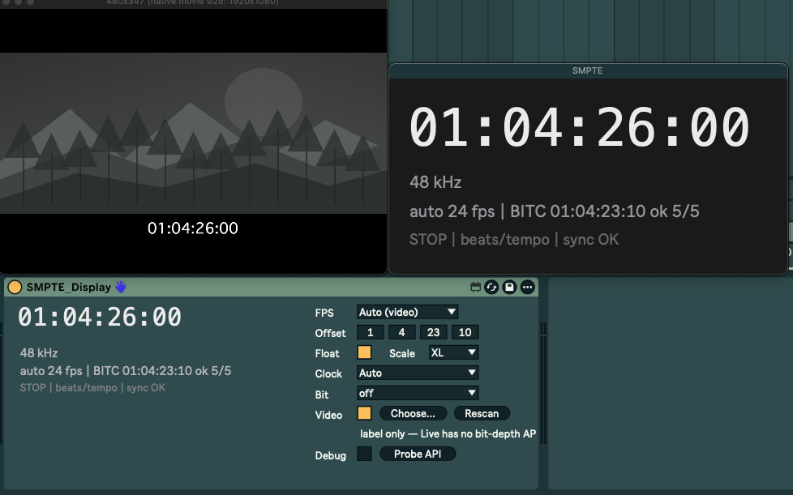

<div align="center">

# SMPTE Display for Ableton Live

**Arrangement View에서 SMPTE 타임코드를 띄워 보고, 타임코드를 입력해 바로 이동하는 Max for Live 디바이스**

[](https://github.com/emile-lab/M4L-SMPTE-Display-For-Ableton-Live/releases/latest)
[](https://www.ableton.com/live/max-for-live/)
[](#요구-사항)
[](LICENSE)

**한국어** · [English](README.en.md)



### [⬇️ Beta 0.4 다운로드](https://github.com/emile-lab/M4L-SMPTE-Display-For-Ableton-Live/releases/latest)

</div>

> [!NOTE]
> **Beta 버전입니다.** 사용해 보시고 문제나 의견이 있으면 [Issues](https://github.com/emile-lab/M4L-SMPTE-Display-For-Ableton-Live/issues/new/choose)에 남겨 주세요.

---

## 주요 기능

| 기능 | 설명 |
|---|---|
| 🕒 **떠 있는 타임코드 창** | Live 위에 작은 창으로 현재 위치를 `HH:MM:SS:FF`로 보여 줍니다. 크기는 S / M / L / XL 중에서 고릅니다. |
| ⌨️ **타임코드로 이동** | 창을 클릭하고 `01:23:45:12`를 입력한 뒤 **Enter**를 누르면 그 위치로 이동합니다. **Space**를 누르면 이동한 다음 재생합니다. |
| 🎬 **영상 FPS 자동 감지** | Arrangement에 있는 영상 클립(MOV / MP4 / M4V)의 프레임레이트를 자동으로 사용합니다. |
| 🔎 **번인 타임코드(BITC) 인식** | 영상 화면에 찍힌 타임코드를 읽어 Offset과 FPS를 자동으로 맞추고, 재생 중에는 `sync OK`로 싱크 상태를 알려 줍니다. 30 fps 파일 안에 24 fps 타임코드가 찍힌 영상처럼 **파일과 화면의 프레임레이트가 달라도** 화면의 타임코드를 따라갑니다. *(macOS)* |
| 📤 **Export 타임코드** | Live에서 Export한 WAV에 타임코드(BWF 타임스탬프)를 기록합니다. Pro Tools, Premiere, Resolve, Nuendo 등에서 영상과 같은 타임코드 위치에 바로 놓입니다. Live Set은 건드리지 않습니다. |
| 🎯 **프레임 정확도** | 정지하거나 클릭한 위치가 프레임 경계에 걸려도 Live 영상 창과 같은 프레임을 표시합니다. 재생 헤드는 건드리지 않으므로 클립 선택이 그대로 유지됩니다. |
| 📈 **템포 오토메이션 대응** | 템포가 바뀌는 구간에서도 실제 경과 시간을 기준으로 정확하게 표시하고 이동합니다. |

지원 프레임레이트: 23.976 · 24 · 25 · 29.97 (NDF / DF) · 30 · 50 · 59.94 (NDF / DF) · 60

## 요구 사항

| 항목 | 내용 |
|---|---|
| Ableton Live | **Live 12 Suite**, 또는 **Standard + Max for Live** (12.4.5에서 테스트) |
| 운영체제 | **macOS 11 이상** (Apple Silicon / Intel). 영상 번인 타임코드 인식은 macOS에서만 동작합니다. |
| Windows | 검증하지 않았습니다. 번인 타임코드 인식은 지원하지 않습니다. |
| 추가 설치 | 없음 |

## 설치 (3단계)

**1. 다운로드 후 압축을 풉니다.**
[Releases](https://github.com/emile-lab/M4L-SMPTE-Display-For-Ableton-Live/releases/latest)에서 `SMPTE_Display_Beta_0.4.zip`을 받아 압축을 풉니다.

**2. macOS 보안 격리를 해제합니다.** *(번인 타임코드 기능에 필요)*
인터넷에서 받은 파일은 macOS가 격리합니다. 이 상태에서는 영상 타임코드 인식 도구(`bitc_reader`)가 실행되지 않습니다. **터미널**을 열고 아래 명령을 입력하세요. 경로는 압축을 푼 위치에 맞게 바꿉니다.

```bash
xattr -dr com.apple.quarantine ~/Downloads/SMPTE_Display_Beta_0.4
```

**3. User Library에 복사하고 트랙에 올립니다.**
1. `SMPTE_Display` 폴더를 **폴더째** 아래 위치에 복사합니다.
   `User Library/Presets/Audio Effects/Max Audio Effect/`
   *(User Library 위치는 Live의 **Settings → Library**에서 확인할 수 있습니다.)*
2. Live 브라우저의 **User Library**에서 `SMPTE_Display.amxd`를 트랙으로 끌어다 놓습니다. **마스터 트랙**에 두는 것을 권장합니다. 오디오는 그대로 통과합니다.

> [!IMPORTANT]
> `SMPTE_Display.amxd`, `.js` 파일 5개, `bitc_reader`는 **반드시 같은 폴더**에 있어야 합니다. `.amxd`만 따로 옮기면 동작하지 않습니다.

> [!TIP]
> **이전 버전(Beta 0.2, DEMO)에서 업데이트할 때:** 기존 `SMPTE_Display` 폴더를 새 폴더로 바꾼 다음, Set에 이미 올려 둔 디바이스는 **지우고 다시 끌어다 놓으세요.** 그대로 두면 이전 버전으로 동작할 수 있습니다.

## 빠른 시작

1. **Arrangement View**로 전환하면 타임코드 창이 화면 가운데에 나타납니다.
2. 디바이스에서 **FPS**를 고릅니다. 기본값 `Auto (video)`는 영상에 찍힌 번인 타임코드의 FPS를, 번인이 없으면 영상 파일의 FPS를, 영상이 없으면 24 fps를 씁니다.
3. 재생하면 타임코드가 실시간으로 바뀝니다.
4. 타임코드를 **클릭** → 입력 → **Enter**로 이동합니다.

### 입력 예시

| 입력 | 이동 위치 |
|---|---|
| `01:23:45:12` | 01:23:45:12 |
| `01:23:45;12` | 01:23:45:12 (드롭 프레임 표기) |
| `1:30:00` | 00:01:30:00 (오른쪽부터 채움) |
| `01101010` | 01:10:10:10 (숫자만 입력) |

### 키 조작

| 키 | 동작 |
|---|---|
| **Enter** | 입력한 위치로 이동합니다. 값이 잘못되면 빨간색으로 표시하고 이동하지 않습니다. |
| **Space** (입력 중) | 입력한 위치로 이동한 뒤 재생합니다. |
| **Space** (입력 중이 아닐 때) | 재생 / 정지 |
| **Esc** | 입력을 취소합니다. 10초 동안 입력이 없을 때도 취소됩니다. |

### 디바이스 설정

| 설정 | 설명 |
|---|---|
| **FPS** | 타임코드 프레임레이트. `Auto (video)`는 영상 화면의 번인 타임코드, 없으면 영상 파일을 따릅니다. |
| **Offset** | 타임라인 0 지점의 타임코드 (예: `01:00:00:00`). 번인 타임코드가 있으면 자동으로 설정됩니다. |
| **Float** / **Scale** | 플로팅 창 켜기·끄기 / 크기 (S · M · L · XL) |
| **Clock** | 시간 계산 방식. 보통은 `Auto`로 두면 됩니다. |
| **Bit** | 화면에 표시할 비트 심도 라벨입니다. Live에서 자동으로 읽을 수 없어 직접 지정합니다. |
| **Choose…** / **Rescan** | 영상 파일을 직접 고르거나, Arrangement의 영상을 다시 찾습니다. |
| **Stamp WAV…** | Export한 WAV에 타임코드를 기록합니다. [아래](#export-타임코드-bwf-타임스탬프) 참고. |

## 영상 번인 타임코드 (BITC) 자동 맞춤 — macOS

영상 화면에 타임코드가 찍혀 있으면 디바이스가 프레임 11개를 읽어 **Offset을 자동으로 맞춥니다.** 화면의 타임코드가 파일과 다른 프레임레이트로 흐르는 경우(예: 24 fps로 편집한 영상을 30 fps로 내보내 5프레임마다 1프레임이 반복되는 파일)에도 화면의 타임코드를 기준으로 삼습니다. 이때 FPS `Auto`는 화면의 프레임레이트를 쓰고, 영상 클립 구간에서는 **반복되는 프레임까지 화면과 똑같이** 표시합니다. 타임코드를 입력해 이동하면 그 타임코드가 처음 보이는 프레임으로 갑니다.

| 정보 줄 표시 | 의미 |
|---|---|
| `BITC 00:59:56:00 ok 11/11` | 인식에 성공해 Offset을 적용했습니다. |
| `auto 24 fps (burn-in, video 30)` | 화면 타임코드는 24 fps, 영상 파일은 30 fps입니다. 화면을 따릅니다. |
| `BITC mismatch 8/11` | 읽은 값들이 서로 맞지 않아 적용하지 않았습니다. |
| `BITC 24 fps != 30 fps` | FPS를 직접 골랐는데 화면의 타임코드와 다릅니다. FPS를 `Auto`로 두면 화면을 따릅니다. |
| `sync OK` / `sync +2 fr` | 재생 중 싱크 상태 (약 5초마다 확인) |
| `clip off frame grid` | 영상 클립이 프레임 경계 사이에 놓여 있습니다. 스냅을 켜고 클립을 격자에 맞춰 주세요. |

## Export 타임코드 (BWF 타임스탬프)

Live가 Export한 WAV에는 타임코드 정보가 없어서, 편집 프로그램이나 다른 DAW로 가져가면 `00:00:00:00`에 놓입니다. **Stamp WAV…**는 Export한 파일에 **Render Start 지점의 타임코드**를 BWF 타임스탬프(`bext`, `iXML`)로 기록합니다. Pro Tools, Premiere Pro, DaVinci Resolve, Nuendo/Cubase, Logic 등에서 "원래 타임스탬프 위치로 배치(Spot)"하면 영상과 같은 타임코드에 정확히 놓입니다.

1. 평소처럼 Live에서 **Export Audio/Video**로 WAV를 내보냅니다.
2. 디바이스의 **Stamp WAV…**를 누르고 내보낸 WAV를 고릅니다. *All Individual Tracks*로 내보낸 경우에는 아무 파일 하나만 고르면 같은 Export의 나머지 파일에도 함께 기록됩니다.
3. 상태 줄에 `TC 01:04:23:10 stamped: 5 WAVs (video clip)`처럼 결과가 나옵니다.

- **Live Set은 바꾸지 않습니다.** 클립, 오토메이션, 트랙 싱크가 그대로이고, 오디오 데이터도 한 바이트도 바뀌지 않습니다. 파일에 타임코드 정보만 추가됩니다.
- 타임스탬프는 **샘플 단위**로 정확합니다. 번인 타임코드로 Offset을 맞췄다면, 영상 클립이 프레임 격자 사이에 놓여 있어도 영상의 실제 위치를 기준으로 계산합니다.
- **Render Start 찾기:** Live는 Export 범위를 알려 주지 않습니다. 그래서 디바이스가 파일 길이로 Export 범위를 알아냅니다. 길이가 **영상 클립, 루프 구간, 두 로케이터 사이, Set 전체** 중 하나와 같으면 그 시작 지점을 쓰고, 아니면 **시작 마커**(시간 선택을 하면 선택의 시작으로 옮겨짐)를 씁니다. 괄호 안에 어느 것을 썼는지 표시됩니다.
- 결과가 예상과 다르면, Arrangement에서 Render Start 지점을 클릭해 시작 마커를 그곳에 둔 다음 다시 **Stamp WAV…**를 누르세요. 여러 번 기록해도 마지막 값만 남습니다.
- WAV만 지원합니다 (AIFF / FLAC / MP3에는 표준 타임스탬프가 없습니다). 4 GB가 넘는 RF64 파일은 지원하지 않습니다.

## 알아 두면 좋은 점

- **SMPTE는 마디·박자가 아니라 경과 시간입니다.** 템포를 바꾸면 같은 마디의 타임코드도 달라집니다. 영상 싱크 기준으로는 이것이 올바른 동작입니다.
- 플로팅 창은 **Arrangement View에서만** 보이고, Session View에서는 숨겨집니다. 창은 Live 메인 창을 따라 움직이지 않습니다.
- **Set 끝보다 뒤로 이동하면** `SMPTE extend`라는 MIDI 트랙과 짧은 빈 클립이 생깁니다. Live는 Set 끝 너머로 이동할 수 없기 때문입니다. Undo로 되돌리거나 지워도 됩니다.
- 디바이스는 재생 헤드를 스스로 옮기지 않습니다. 타임코드를 입력해 이동할 때만 옮깁니다. 그래서 Arrangement에서 고른 클립 선택이 풀리지 않습니다.
- 프레임이 끝나기 직전 위치에서 정지하면, 드물게 Live 영상 창이 다음 프레임을 보여 줄 수 있습니다(SMPTE 표시보다 1프레임 앞). Live 영상 창의 동작이라 디바이스에서 맞출 수 없습니다.
- 플로팅 창에 입력하고 나면 키보드 포커스가 그 창에 남습니다. Live 단축키를 쓰려면 Live 창을 한 번 클릭하세요.

## 문제 해결

<details>
<summary><b>플로팅 창이 보이지 않아요</b></summary>

- Arrangement View인지 확인하세요 (Tab 키로 전환).
- 디바이스의 **Float**가 켜져 있는지 확인하세요.
- 창이 다른 모니터에 떠 있을 수 있습니다. 디바이스를 지우고 다시 올리면 Live 창이 있는 모니터 가운데에 나타납니다.
</details>

<details>
<summary><b>번인 타임코드(BITC)가 인식되지 않아요 / <code>BITC error</code>가 떠요</b></summary>

- [설치 2단계](#설치-3단계)의 `xattr` 명령을 실행했는지 확인하세요. 가장 흔한 원인입니다. 명령을 실행한 뒤에는 **Rescan**을 누르세요.
- 영상 형식이 MOV / MP4 / M4V인지 확인하세요.
- **Rescan**을 누르거나 **Choose…**로 영상 파일을 직접 고르세요.
- 영상 클립이 Warp된 상태면 비교하지 않습니다. 클립의 Warp를 끄세요.
- `BITC 24 fps != 30 fps`처럼 나오면 FPS를 `Auto (video)`로 바꾸세요.
</details>

<details>
<summary><b><code>TC stamp failed</code>가 떠요</b></summary>

- `length fits video clip and loop …`: 파일 길이에 맞는 구간이 여러 개입니다. Render Start 지점을 클릭해 시작 마커를 그곳에 두고 다시 누르세요.
- `render start unknown`: 템포 오토메이션 구간에서 아직 재생하지 않은 위치입니다. Render Start 지점부터 한 번 재생한 뒤 다시 누르세요.
- `RF64 WAV (over 4 GB) is not supported`: 4 GB가 넘는 파일입니다. 트랙별로 나눠서 내보내세요.
- 파일이 다른 프로그램에서 열려 있으면 기록하지 못할 수 있습니다.
</details>

<details>
<summary><b>타임코드가 <code>--:--:--:--</code>로만 나와요</b></summary>

- Session View에 있으면 Arrangement View로 전환하세요.
- 디바이스 전원이 켜져 있는지 확인하세요.
- FPS를 직접 골라 보세요.
</details>

<details>
<summary><b>업데이트했는데 예전처럼 동작해요</b></summary>

Set에 이미 올라가 있는 디바이스는 이전 버전으로 계속 동작할 수 있습니다. 트랙에서 지우고 브라우저에서 다시 끌어다 놓으세요.
</details>

<details>
<summary><b><code>beyond the end of the Set</code> / <code>could not extend the Set</code> 에러가 떠요</b></summary>

입력한 위치가 Set 끝보다 뒤인데 Set을 자동으로 늘리지 못한 경우입니다. 입력하려는 위치보다 뒤에 Arrangement 클립을 하나 둔 다음 다시 시도하세요.
</details>

해결되지 않으면 [버그 리포트](https://github.com/emile-lab/M4L-SMPTE-Display-For-Ableton-Live/issues/new?template=bug_report.yml)를 남겨 주세요.

## 변경 내역

버전별 변경 사항은 [CHANGELOG.md](CHANGELOG.md)에 있습니다.

## 라이선스

**Copyright © 2026 전민기 (Jeon Min Gi). All rights reserved.**

- ✅ 개인 작업과 **상업 프로젝트**(음악·영상 작업 등)에 무료로 사용할 수 있습니다.
- ❌ 디바이스 파일의 **재배포, 재업로드, 판매, 수정본 배포**는 금지합니다.
- 🔗 다른 사람에게 소개할 때는 파일 대신 **이 저장소 링크**를 공유해 주세요.

자세한 조건은 [LICENSE](LICENSE)를 확인하세요.

---

<sub>Ableton, Ableton Live, Max for Live는 Ableton AG의 상표이고, Max는 Cycling '74의 상표입니다. 이 프로젝트는 Ableton 및 Cycling '74와 관련이 없습니다.</sub>
